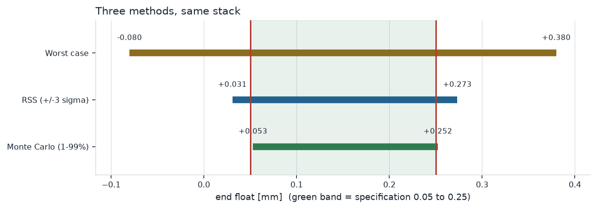
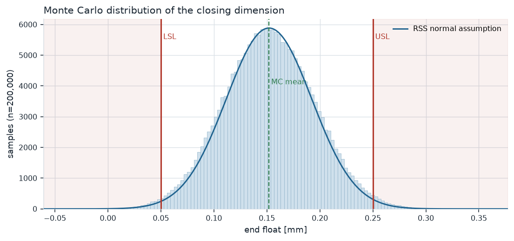
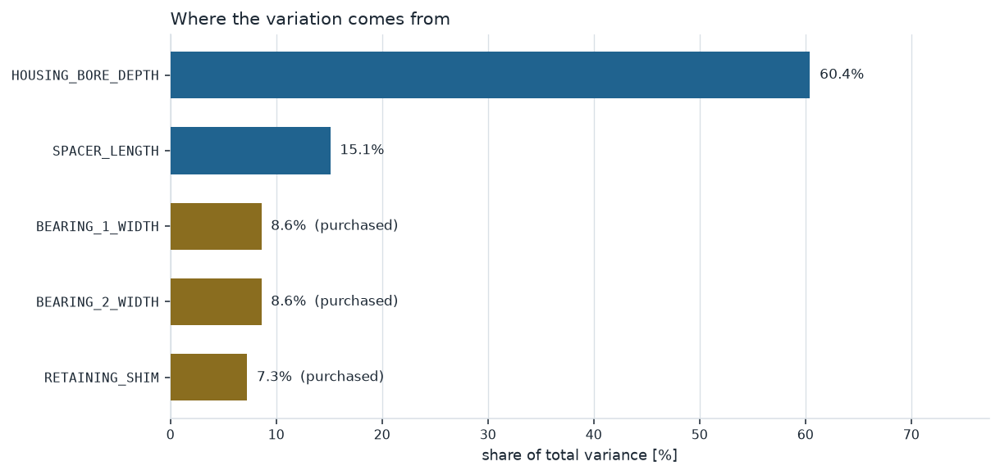

# Tolerance Stack-up: Worst Case vs RSS vs Monte Carlo

Takes a 1D assembly stack described in JSON and answers what a designer
actually needs to know before releasing the drawing:

1. **Does it always fit?** — worst case.
2. **How often does it fit?** — RSS and Monte Carlo, with predicted scrap.
3. **Which tolerance is costing the money?** — variance contribution.
4. **What would it take to fix?** — tolerance allocation to a target Cpk.

The three methods disagree on purpose. Worst case over-designs, RSS is
optimistic exactly where its normality assumption fails, and Monte Carlo
samples whatever the stack actually declares. Quantifying that gap is the
whole deliverable.

```bash
pip install -r requirements.txt
python run.py                  # bundled example, writes out/report.pdf
python tests/test_stackup.py   # 16 checks against closed-form values
```

---

## Result on the example stack

A gearbox shaft carried on two deep-groove ball bearings, located by a spacer
and a ground shim in a housing bore. The closing dimension is axial **end
float**, which must stay positive (no preload on the bearings) and bounded
(no excessive play): **0.05 to 0.25 mm**.

| Method | Mean | Low | High | Scrap | Cpk |
|---|---|---|---|---|---|
| Worst case | 0.150 | **−0.080** | **0.380** | — | — |
| RSS (±3σ) | 0.152 | 0.031 | 0.273 | 13 461 ppm | 0.81 |
| Monte Carlo (1–99%) | 0.152 | 0.053 | 0.252 | **19 860 ppm** | **0.76** |



### Finding 1 — worst case says impossible, and that is not the answer

The worst-case band is −0.080 to 0.380 mm against a 0.05–0.25 mm requirement.
Taken literally the design is dead: the stack permits axial interference.

But worst case assumes all five parts sit at their extreme limits *in the same
direction at the same time*, and at ±3σ each that combination has a probability
of roughly 10⁻¹². The honest reading is that **this stack cannot be justified by
inspection and has to be justified statistically** — which is the normal state
of affairs for any stack longer than two or three parts.

Worst case is 1.90× wider than RSS here. That ratio is √n for n equal
contributors, and it is the cost of designing to worst case: tolerances roughly
twice as tight as the function needs.

### Finding 2 — Monte Carlo is 48% worse than RSS, and names the reason

RSS predicts 13 461 ppm. Monte Carlo predicts 19 860 ppm — **6 399 ppm worse**,
on the same nominals and the same tolerances.

The difference is entirely in the assumptions RSS makes and the stack denies:

- The **shim** is sorted ground stock, so its thickness is near-**uniform**
  across the band, not normal. A uniform distribution has σ = band/√12, which
  is 1.73× wider than the band/6 that the tolerance-equals-3σ convention
  assumes.
- The **bearing widths** are **skewed high** — the supplier grinds into the
  upper half of the DIN 620 band.
- The **housing bore** carries a **0.3σ mean shift** for thermal drift across
  a shift.

Net effect: the true σ is 6.1% larger than RSS computes (0.04287 vs 0.04041 mm),
and because scrap lives in the tails, a 6% error in σ becomes a 48% error in
ppm. **This is the argument for Monte Carlo in one number** — not that it is
more sophisticated, but that RSS silently assumed three things that were false.



Rejects split 1 664 low and 2 308 high. The imbalance is small but real, and it
matters for the fix: a lopsided split is a nominal problem (move the spacer
length), an even split is a variation problem (tighten something). Here it is
close to even, so this is a variation problem.

### Finding 3 — one tolerance owns the stack

| Contributor | σ (mm) | Variance share | |
|---|---|---|---|
| `HOUSING_BORE_DEPTH` | 0.0333 | **60.4%** | machined |
| `SPACER_LENGTH` | 0.0167 | 15.1% | machined |
| `BEARING_1_WIDTH` | 0.0126 | 8.6% | purchased |
| `BEARING_2_WIDTH` | 0.0126 | 8.6% | purchased |
| `RETAINING_SHIM` | 0.0115 | 7.3% | purchased |



Variance adds, not tolerance, so **share scales with the square of the
tolerance**. The housing bore at ±0.10 mm carries 60% of the variation on its
own; the three purchased parts together carry 24%. Tightening the shim would be
a waste of a supplier conversation.

### Finding 4 — what it takes to reach Cpk 1.33

Scaling only the two in-house tolerances by **×0.508**:

| | Current | Required |
|---|---|---|
| `HOUSING_BORE_DEPTH` | ±0.100 | **±0.051** |
| `SPACER_LENGTH` | ±0.050 | **±0.025** |

Purchased parts held fixed. ±0.051 mm on a 60 mm bore depth is demanding but
ordinary on a machining centre; Cpk 1.67 would need ×0.315, i.e. ±0.032 mm,
which is where the conversation turns to a different process or a shim-to-fit
step.

The allocator solves this analytically — σ² = s²A + B, with A from the
adjustable contributors and B from the fixed ones — and **reports infeasible
when B alone blows the budget**, which is the honest answer when the problem is
a purchased part and no drawing change can reach the target.

## Stack definition format

```json
{
  "name": "Gearbox shaft axial end float",
  "lsl": 0.05, "usl": 0.25, "unit": "mm",
  "sigma_per_tolerance": 3.0,
  "contributors": [
    {
      "name": "HOUSING_BORE_DEPTH",
      "nominal": 60.0, "lower": -0.10, "upper": 0.10,
      "direction": 1,
      "distribution": "normal", "mean_shift": 0.3,
      "adjustable": true, "source": "machined in-house"
    }
  ]
}
```

- `direction` is **+1** if growing that dimension opens the gap, **−1** if it
  closes it. The closing dimension is `sum(direction × dimension)`.
- `distribution` is `normal`, `uniform`, or `triangular` (with `mode` as a
  deviation, for a skewed supplier process).
- `mean_shift` is in σ and applies to normal contributors only — a shift in σ
  has no agreed meaning for the other shapes, so the loader rejects it rather
  than guessing.
- `adjustable: false` marks a purchased part the allocator must not tighten.
- `sigma_per_tolerance` is the convention linking tolerance to σ: 3.0 means the
  tolerance band is ±3σ (Cp = 1.0 at the part level).

Unknown keys are rejected at load — a typo'd `"mode"` silently ignored would
change the answer without changing the report.

## Testing

Anchors with closed-form answers, not golden output:

- worst case grows as **n·t**, RSS as **t·√n** — asserted exactly for n = 1…10
- their ratio is exactly **√n** for equal contributors
- a stack centred with the spec at ±3σ predicts **2 699.8 ppm**
- uniform variance = band²/12; triangular mean and variance against the closed
  form; and the samplers must reproduce both to within 2%
- Monte Carlo must **agree** with RSS when all contributors are normal and
  centred, and must come out **worse** when one is uniform
- a mean shift must move the mean without changing σ
- the allocator's returned scale, applied, must land on the requested Cpk
- invalid definitions (unknown distribution, inverted band, mode outside the
  band, a shift on a non-normal part) must all raise

```
16/16 passed
```

Two of these caught real mistakes while writing the tests rather than the code,
and one is worth keeping in mind as a modelling point: **four uniform
contributors of ±0.05 are bounded at exactly ±0.2**, so against a ±0.2 spec
both the normal and uniform stacks show zero fallout and prove nothing. Bounded
distributions can make a stack provably safe in a way a normal assumption never
reports.

## Fachbegriffe

| English | Deutsch |
|---|---|
| Tolerance stack-up | Toleranzkette / Maßkette |
| Worst case | Arithmetische Tolerierung (Maximum-Minimum) |
| Statistical tolerancing (RSS) | Statistische Tolerierung |
| Closing dimension | Schließmaß |
| Contributor | Einzelmaß / Kettenglied |
| Clearance / interference | Spiel / Übermaß |
| End float | Axialspiel |
| Tolerance allocation | Toleranzvergabe / Toleranzaufteilung |
| Selective assembly | Selektive Montage / Paarung |
| Shim | Passscheibe |
| Process capability | Prozessfähigkeit |
| Scrap | Ausschuss |

## Scope

Linear 1D stack: every sensitivity coefficient is ±1. Not modelled — geometric
and kinematic stacks where a sensitivity is not unity, GD&T bonus tolerance at
MMC, form and orientation effects, thermal expansion, and assembly-induced
deflection. Those matter on a real gearbox and would change the answer; this
tool is the 1D axial case, which is the one that covers most shim-and-spacer
problems.

The example stack is synthetic but dimensionally realistic. Distribution shapes
and the mean shift are stated assumptions, recorded in the JSON with the reason
for each, not fitted to measured data — on a real job they would come from
capability studies, which is what [cmm-spc-dashboard](https://github.com/Pratsss24/cmm-spc-dashboard)
produces.

---

Built by [Prathamesh Bedre](https://github.com/Pratsss24) — M.Sc. Intelligent
Manufacturing, TU Clausthal. Background: ~2 years mechanical design (hydraulic
press systems, precision electromechanical parts), plus series production
metrology on a Mercedes-Benz vehicle line.
